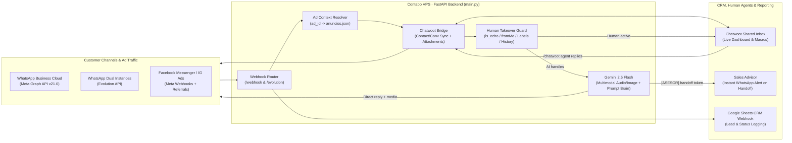

# Omnichannel AI Sales & Support Agent (`Caminos 1524` · Contabo VPS)

Production **FastAPI** orchestration backend deploying a multimodal **Gemini 2.5 Flash** prospect/support agent across **WhatsApp Business Cloud**, **Evolution API (dual WhatsApp instances)**, **Facebook Messenger**, **Chatwoot**, and **Google Sheets CRM**—hosted on a Contabo Linux VPS.

> All private API keys, webhook secrets, staff phone numbers, and server filepaths have been parameterized cleanly via environment variables (see [`../../.env.example`](../../.env.example)).

---

## System Architecture

---

## Key Engineering Highlights

1. **Zero-Collision Human Takeover Detection (`GUARD`):**
   - Automatically silences the AI bot whenever a human rep replies from **Chatwoot** (`humano_intervino`), **Meta Business Suite** (`is_echo` webhook detection outside bot hashes), or **mobile WhatsApp** (`fromMe`), preventing bot-vs-human double-messaging.
2. **Multimodal Customer Ingestion (Audio & Images):**
   - Downloads incoming voice notes (`audio/ogg`) and product screenshots (`image/jpeg`) directly from Meta Graph API v21.0 and passes them natively to Gemini via `types.Part.from_bytes`.
3. **Structured AI-to-Human Escalation (`[ASESOR]` Token):**
   - Prompted for consultative pre-qualification (never pushy): once buying intent, sizing confirmation, or payment questions appear, Gemini emits `[ASESOR]`, triggering:
     - Clean customer handoff message
     - Chatwoot label (`requiere_asesor`) + conversation sync
     - Real-time WhatsApp alert to the assigned advisor
     - Google Sheets lead classification sync
4. **Click-to-WhatsApp / Messenger Ad Attribution:**
   - Captures Meta `referral.source_id` / `externalAdReply` payloads, resolves ad names against `anuncios.json`, and injects exact campaign context into Gemini's hidden turn context.
5. **Modular Knowledge Brain & Agent Macros:**
   - Dynamically loads modular Markdown/text instructions (`01_personalidad.txt`, `02_catalogo.txt`, `03_inventario.txt`, `04_escenarios.txt`) so business operators can update catalog stock without redeploying Python code.
   - Paired with standardized Chatwoot closer macros ([`chatwoot_macros_guide.md`](./chatwoot_macros_guide.md)).

---

## Files

- [`main.py`](./main.py) — Sanitized production FastAPI application (webhooks, Chatwoot bridge, Meta/Evolution dispatchers, Gemini multimodal agent).
- [`chatwoot_macros_guide.md`](./chatwoot_macros_guide.md) — Standardized operational Chatwoot macros (Payment Closing, Delivery Logistics Form, Sizing Calibration, Inventory Urgency).
