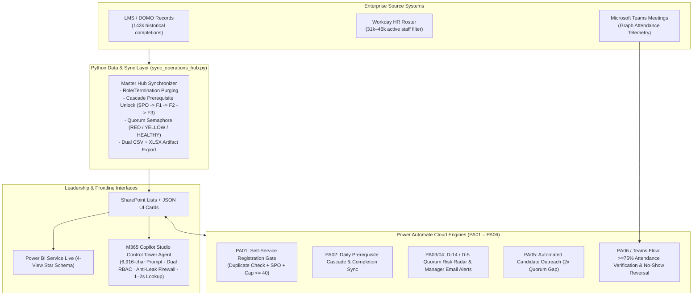

# Live Enterprise Compliance Hub & Control Tower (9–12 Workflows + M365 Copilot Agent)

End-to-end production operations system automating instructor-led training (ILT), compliance prerequisite enforcement, quorum risk prevention, attendance auditing, and executive C-level reporting across **10 LATAM countries** and **9,098 target leaders** for a Global Enterprise BPO Partner.

> All corporate tenant URLs, email addresses, SharePoint endpoints, and local filepaths have been parameterized for confidentiality.

---

## Verified Business Impact & ROI

| Metric | Verified Operational Result |
| :--- | :--- |
| **Engineering Investment** | `115.0 hours` across 8 modular phases |
| **Annual Hours Reclaimed** | **`1,314.0 hours/year`** across 9–12 live operational workflows |
| **Cycle Time Reduction** | **`45.0 min` avg manual handling → `2.5 min`** (`~94%` reduction) |
| **First-Year Return (ROI)** | **`11.4x ROI`** (`4.5-week` payback · `$32,850 – $39,420 USD/yr` corporate labor equivalent) |
| **Audience Governed** | **9,098 target leaders** (TLs / Sr. TLs / Trainees across 10 LATAM countries) |

---

## Architecture Overview

---

## Key Workflow Modules Implemented

1. **Sequential Prerequisite Cascade (`sync_operations_hub.py`):**
   - Automatically transitions leader paths from `Blocked` → `Pending` → `Enrolled` → `Completed` across 4 sequential tiers (`Pre-Req SPO -> Stage F1 -> Stage F2 -> Stage F3`) based on verified LMS completion keys (`EmployeeID___CourseName`).
2. **Proactive Quorum Risk Engine (`RED` / `YELLOW` / `HEALTHY`):**
   - Evaluates upcoming cohorts (`20` min quorum / `40` max seats), flags sessions `<= 7 days` below `20` enrollments as `RED`, computes exact `Quorum_Gap`, and generates candidate outreach ledgers so sessions never cancel unexpectedly.
3. **Zero-Touch Teams Attendance & No-Show Reversal (`teams_attendance_flow.json`):**
   - Production Azure Logic Apps / Power Automate JSON definition triggered automatically when any Teams training call ends:
     - Calls Teams Attendance Report API & resolves `EmployeeID` via `Office365Users.UserProfile_V2`
     - Computes exact participant duration (`>= 75%` of session length)
     - Classifies attendees (`Pre-Registered` vs. `Walk-in`), marks absent enrollees as `No-Show`, reverts their backlog row cleanly to `Pending`, and posts a channel summary card.
4. **M365 Copilot Studio Control Tower Agent:**
   - Governed by a deterministic `6,916`-character system prompt enforcing Dual RBAC (self-service registration for learners vs. operational telemetry for leads), Anti-Leak data guardrails, duplicate/prereq gates, and fast dual `.csv/.xlsx` lookup (`1–2s` response time).

---

## Files

- [`sync_operations_hub.py`](./sync_operations_hub.py) — Sanitized master Python reconciliation & KPI summary generator.
- [`teams_attendance_flow.json`](./teams_attendance_flow.json) — Sanitized Azure Logic Apps / Power Automate cloud workflow definition.
