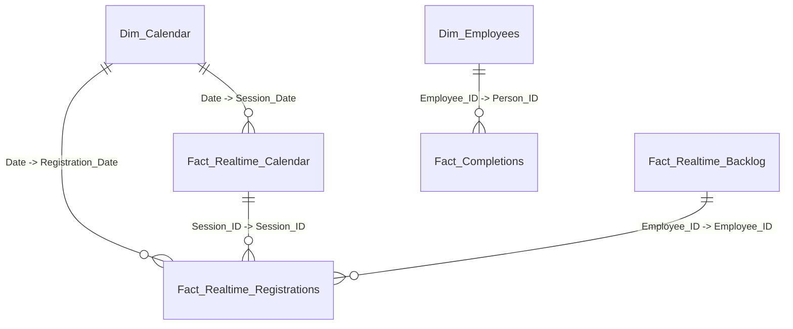

# Automated BI & Headless RPA Reporting Pipelines

Production reporting infrastructure replacing slow manual BI exports, spreadsheet merging, and multi-system reconciliations for regional operations across **143k+ LMS completion rows** and **31k–45k active HR records**.

> All corporate tenant endpoints, internal SharePoint URLs, and SSO profiles have been parameterized safely via environment variables.

---

## Documented Automation Portfolio (`424 hrs/yr` Direct Reporting Savings)

| Component | Stack | Scope & Measured Result |
| :--- | :--- | :--- |
| **1. Headless DOMO RPA Extractor** | Python, Playwright / Chromium, Pandas, Windows Scheduler | Unattended login check -> Controls `All Time` filter -> card expansion assertion -> `143k`-row CSV export & normalization (`72 hrs/yr` saved). |
| **2. Workday Active Staff ETL Pipeline** | Python, Pandas, Scheduled Task | Automates `57 MB+` HR active roster ingestion across `31,679+` records, purges inactive/exempt records, and publishes clean Star Schema dimension CSVs (`72 hrs/yr` saved). |
| **3. Power BI Live 4-View Star Schema** | Power Query (`M`), DAX, SharePoint v2.0 | Live executive, calendar quorum, risk management, and manager backlog dashboards reconciling `2,834+` active leaders (`280 hrs/yr` saved). |

*(Paired with the 9–12 workflow Operations Hub, total documented annual hours reclaimed reaches **`1,738 hours/year`** across regional operations and reporting.)*

---

## Star Schema Data Architecture

### 4-View Dashboard Design
1. **Executive Overview:** Unique target leaders, backlog completion %, active seat occupancy across countries/tracks.
2. **Monthly Session & Quorum Calendar:** Color-coded quorum semaphore (`Green 20–35`, `Orange 36–39`, `Red 40/40 Full`, `Amber 1–19 Pending Quorum`) + facilitator load hours.
3. **Operational Risk Management:** Critical alerts (`<= 7 days` & `< 20` enrolled), stage prerequisite blockers, cancellation & no-show rate tracking.
4. **Manager Backlog Drill-Down:** Hierarchical country → manager → direct-report audit table for weekly accountability.

---

## Files

- [`domo_playwright_rpa.py`](./domo_playwright_rpa.py) — Sanitized unattended Playwright Chromium RPA extractor with persistent SSO session check, card title validation, warning-row stripping, schema matching, and chained Power BI build trigger.
- [`power_query_star_schema.m`](./power_query_star_schema.m) — Sanitized production Power Query (`M`) definitions connecting live SharePoint Lists v2.0 into Power BI Desktop & Service.
