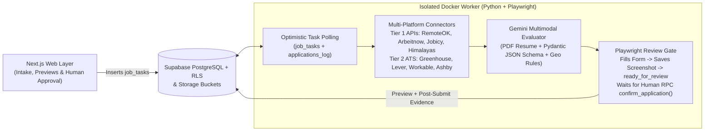

# Distributed AI Job-Matching & Automation Worker (`Next.js + Supabase + Docker Worker + Gemini`)

Full-stack decoupled SaaS & daily intelligence architecture pairing a **Next.js web frontend** with an isolated **Dockerized Python + Playwright worker**, connected strictly through **PostgreSQL (Supabase)** queues and **Row-Level Security (RLS)**.

> Sanitized architecture & code showcase (zero deployment keys, webhook secrets, or user PII).

---

## System Architecture

---

## Key Engineering Design Patterns

1. **Human-in-the-Loop Execution Gate (Zero Blind Auto-Apply):**
   - Workers never submit without explicit user consent. First pass populates supported ATS fields, uploads resume bytes, captures a `preview_screenshot_path`, and writes status `ready_for_review`.
   - Only after the user invokes PostgreSQL RPC `public.confirm_application(id)` (`confirmed`), the worker acquires an optimistic lock (`submitting`) and captures `post_submit_screenshot_path`.
2. **ToS & Risk-Tier Platform Governance (`job_platforms`):**
   - **Tiers 1–2 (`auto_apply`):** Public JSON job APIs (`RemoteOK`, `Arbeitnow`, `Jobicy`, `Himalayas`) and open ATS endpoints (`Greenhouse`, `Lever`, `Workable`, `Ashby`).
   - **Tiers 3–4 (`manual_suggested`):** Protected or anti-bot domains (`LinkedIn`, `Indeed`, `Jobgether`) never automated—resolved safely into deep-link search templates.
3. **Structured Output Gemini Evaluation (`matching_engine.py`):**
   - Sends raw PDF bytes (`types.Part.from_bytes`) alongside batched, HTML-stripped job descriptions and historical rejection feedback.
   - Enforces typed `Pydantic` JSON schema (`job_index`, `match_score`, `match_reason`, `cover_letter`), strict geo-eligibility enforcement (`Remote - US Only` vs. `Global / LATAM`), and `MAX_NEAR_MISSES` explainability.
4. **Daily Calibration & Fuzzy Deduplication Extension:**
   - Extended locally via a scheduled multi-source scanner pairing `openpyxl` workbook deduplication, normalized URL/token fuzzy checks, tailored 1-page A4 Playwright PDF CV rendering, and `ntfy` mobile push notifications.

---

## Files

- [`matching_engine.py`](./matching_engine.py) — Multimodal Gemini + Pydantic structured matching & near-miss engine.
- [`supabase_schema_excerpt.sql`](./supabase_schema_excerpt.sql) — PostgreSQL table, enum, platform risk-tier seed, and RLS schema design.
